# Endfield Tray


一个为 **KDE Plasma 6 + Wayland** 编写的紧凑型悬浮任务栏。视觉语言参考《明日方舟：终末地》的 HUD：暖灰外壳、橄榄荧光绿、细线框、等宽小字和菱形标记。

它不是 Plasma 小组件，而是一个独立的 **Qt 6 / Qt Quick + LayerShell** 程序；不依赖 Plasma 面板布局，可以悬浮在屏幕底部中央，并在全屏应用、Show Desktop、混合 DPI 等场景下保持正确行为。

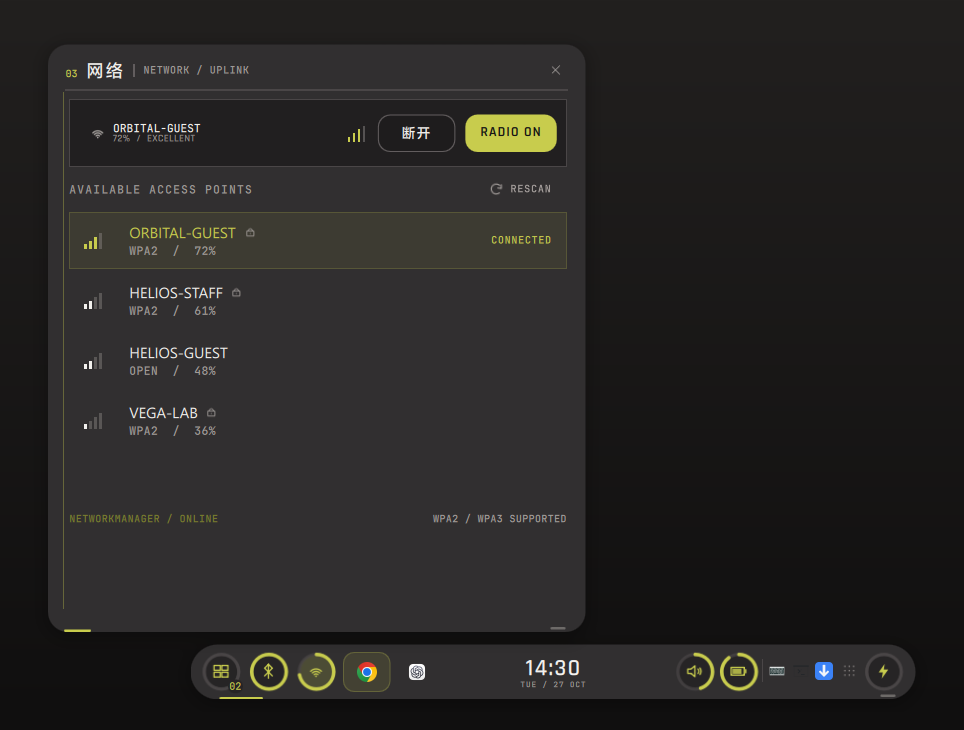

> 非官方粉丝作品，与《明日方舟：终末地》的开发方 / 发行方无隶属关系。视觉参考项目见下方[参考与灵感](#参考与灵感)。

## 目录

- [功能](#功能)
- [安装](#安装)
  - [Homebrew（推荐）](#homebrew推荐)
  - [Arch / CachyOS 依赖](#arch--cachyos-依赖)
  - [从源码构建](#从源码构建)
  - [安装脚本](#安装脚本)
  - [开机自启动](#开机自启动)
  - [隐藏 KDE 面板](#隐藏-kde-面板)
  - [升级与卸载](#升级与卸载)
- [使用](#使用)
- [胶囊 OSD](#胶囊-osd)
- [配置](#配置)
- [设计说明](#设计说明)
- [代码结构](#代码结构)
- [开发与截图](#开发与截图)
- [已知限制](#已知限制)
- [参考与灵感](#参考与灵感)
- [License](#license)

## 功能

### 悬浮胶囊

- **展开条**：约 `580 × 44` 逻辑像素，底部居中悬浮，和屏幕底边保留 10 px 空隙。
- **收缩胶囊**：鼠标离开后收缩为 `108 × 44` 的时间胶囊。
- **轻投影**：外壳为纯色 `#312F30`，没有外描边和渐变；条和面板外侧只有柔和阴影。
- **输入区域裁剪**：LayerShell 表面只占据屏幕底部 `620 px`；Wayland 输入区域严格跟随条、分组浮层和当前面板，透明区域不会吞掉桌面点击。

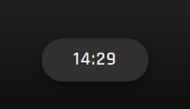


### 详情面板

| 窗口 | 电源 |
| --- | --- |
| 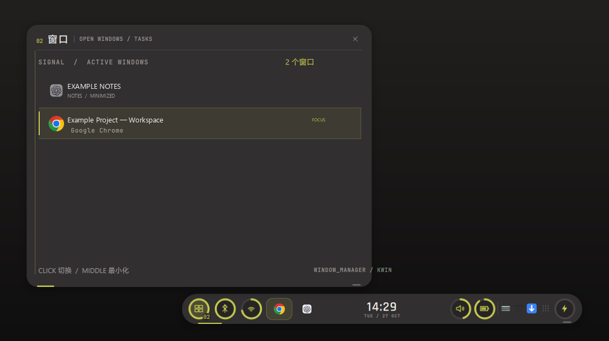 | 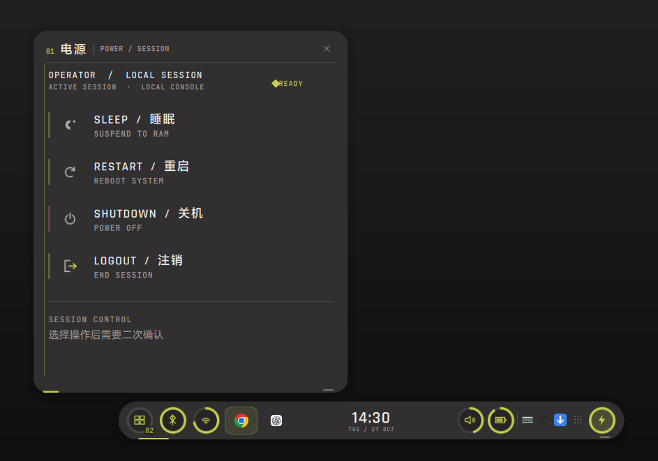 |
| 切换窗口、中键最小化、悬停关闭、最近窗口分组。 | 睡眠、重启、关机、注销；所有操作均需二次确认。 |

| Wi-Fi | 蓝牙 |
| --- | --- |
|  | 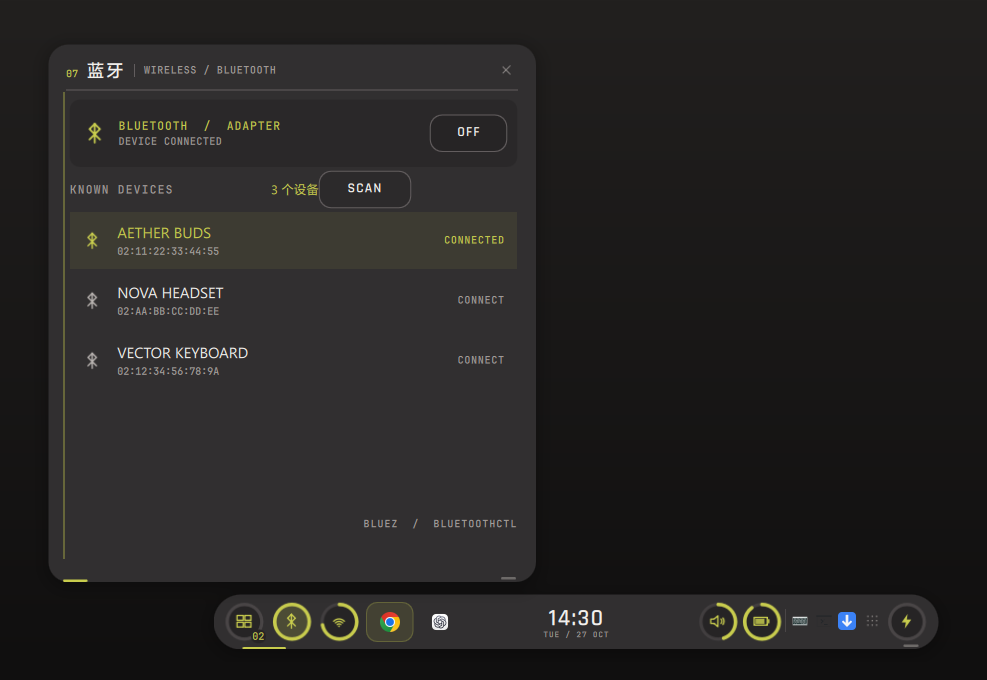 |
| 扫描、连接（含密码）、断开、开关 radio；状态条不显示 SSID。 | 开关适配器、扫描、连接 / 断开已知设备。 |

| 音量 / 输出设备 | 电池 / 电源模式 |
| --- | --- |
| 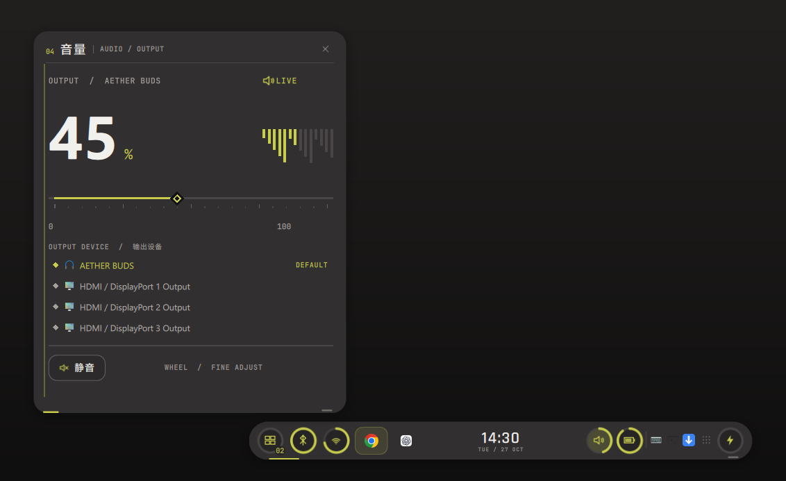 | 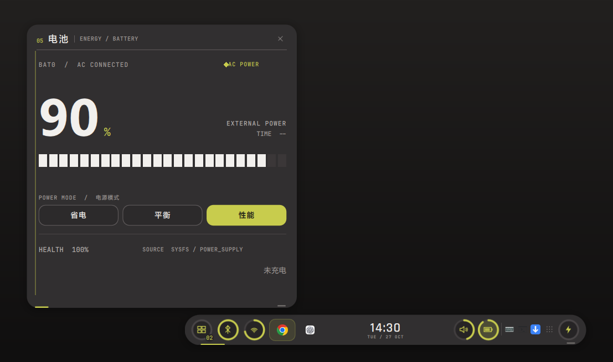 |
| 音量滑块、滚轮、静音、输出设备切换。 | 电量、充电状态、剩余时间、健康度、省电 / 平衡 / 性能模式。 |

| 系统托盘 | 托盘菜单 |
| --- | --- |
| 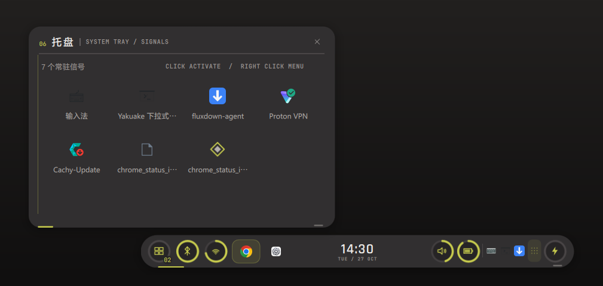 | 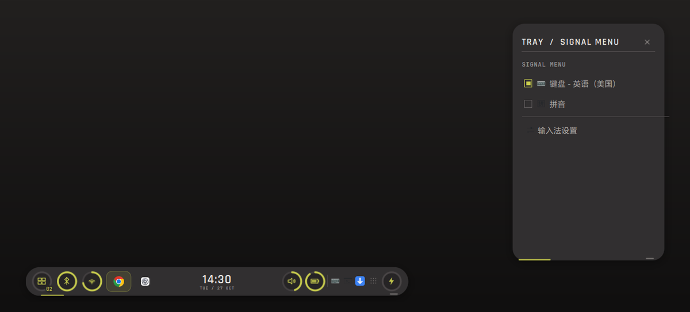 |
| 自带 StatusNotifierItem host，不依赖 Plasma 系统托盘。 | 支持 DBusMenu 子菜单、左键激活和中键行为。 |

### 圆环徽章

Wi-Fi、音量、电池使用参考 HUD 的圆环进度；窗口、蓝牙和电源是按钮型圆环，外圈只表示按钮边界，不伪装成进度。圆环只在数值、状态或 hover 改变时重绘。

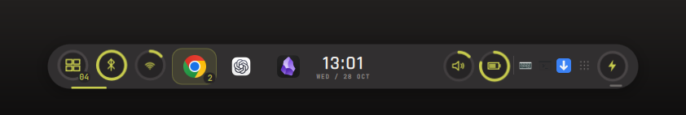

### 窗口与最近应用

- 从 Plasma `LibTaskManager` 读取窗口，点击切换、中键最小化。
- 最近应用按 `appId` 分组：同一个应用只占一个位置，不显示应用名。
- 展开条中最多显示 3 个最近应用图标；多窗口组悬停时在上方展开窗口列表；剩余窗口仍在 `WINDOWS` 面板中。
- 窗口标题使用系统 UI 字体，避免中英文混排时字重和宽度不一致。

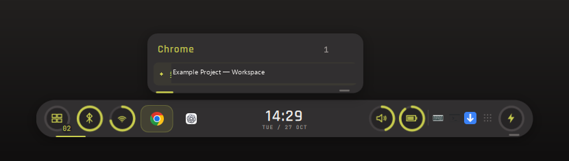

### 系统托盘

- 原生 `StatusNotifierItem` host，支持：
  - 左键激活
  - 右键 / `ItemIsMenu` 打开 DBusMenu
  - 子菜单、分隔线、勾选状态
  - 托盘抽屉查看全部项目
- 托盘的 `IconName` 使用主题图标；少数只提供 pixmap 的应用会显示占位菱形。

### 不抢焦点 / 外部操作

- 打开详情页不会激活 HUD，也不会打断当前窗口的键盘焦点。
- Wayland 输入区域只覆盖条和当前面板，网页滚动、点击外部窗口仍然正常。
- 鼠标离开条和面板约 300 ms 后，面板自动关闭，条收缩为时间胶囊。
- 只有 Wi-Fi 密码输入时才临时请求键盘焦点。

### 全屏与 Show Desktop

- 当前活动窗口进入全屏时，HUD 完全隐藏并清空输入区域；退出全屏后恢复为时间胶囊。
- LayerShell scope 使用 `dock`，Show Desktop 不会把 HUD 一起隐藏。

### 性能

- 没有常驻扫描线、粒子或循环动画；收缩后暂停音频、网络、电池和托盘轮询。
- 详情面板按需加载：未打开时不创建列表、图标委托和面板树。
- 透明层只覆盖屏幕底部 `620 px`，不再占用全屏缓冲。
- 实测空闲约 **155 MB RSS / 51 MB PSS / 35 MB private dirty**；RSS 包含 Qt、Mesa、字体等共享库。
- 音量使用 `pactl subscribe` 事件；屏幕 / 键盘亮度使用 PowerDevil D-Bus 信号。它们都不需要为了更新数值而持续轮询。

## 胶囊 OSD

### 音量

胶囊收起时改变音量：

- 时间先完全淡出。
- 时间被音量百分比替换；胶囊内边框显示黄色进度环。
- 约 2 秒后，音量 OSD 完全淡出，时间再淡入。
- 连续改变音量会刷新数值和 2 秒计时。

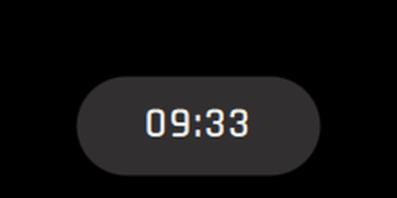

### 屏幕与键盘亮度

屏幕亮度和键盘亮度使用同一套胶囊 OSD，分别带有太阳 / 键盘图标：

| 屏幕亮度 | 键盘亮度 |
| --- | --- |
| 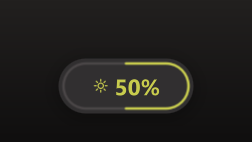 | 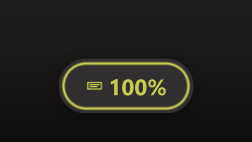 |

- 通过 PowerDevil D-Bus 的 `brightnessChanged` / `keyboardBrightnessChanged` 事件更新。
- 初始值在启动时静默读取，不会在登录时闪一次 OSD。
- 与音量一样：先完成旧内容淡出，再淡入新内容；2 秒后恢复时间。

## 安装

### 环境要求

| 组件 | 要求 |
| --- | --- |
| 会话 | KDE Plasma 6，**Wayland**（不支持纯 X11 悬浮定位） |
| Qt | Qt 6.9+；测试环境为 6.12 |
| 合成器 | KWin 6.8+ |
| 系统服务 | NetworkManager、PipeWire + WirePlumber、BlueZ、power-profiles-daemon |
| 构建 | CMake、Ninja、C++20 编译器 |

已验证环境：

- CachyOS Linux（Arch 系）
- KDE Plasma 6.8.1 / KWin 6.8.1 / Wayland
- Qt 6.12.0
- 1920×1200，125% 缩放

### Homebrew（推荐）

预编译二进制通过 Homebrew Linux tap 安装，不需要用 Homebrew 重新构建 Qt：

```bash
brew tap hhdtc/tap
brew install endfield-tray
```

启动：

```bash
endfield-tray
```

Homebrew 只安装二进制和桌面文件；Qt、KDE Plasma、NetworkManager、PipeWire、BlueZ 仍由系统包提供。

### Arch / CachyOS 依赖

```bash
sudo pacman -S --needed \
  base-devel cmake ninja \
  qt6-base qt6-declarative qt6-wayland \
  layer-shell-qt plasma-workspace \
  networkmanager pipewire wireplumber \
  bluez-utils power-profiles-daemon glib2
```

`plasma-workspace` 提供 `LibTaskManager` 和 Plasma 窗口任务接口；`pipewire` / `wireplumber` 提供 `wpctl` 和 `pactl` 的后端；`power-profiles-daemon` 提供电源模式。

### 从源码构建

```bash
git clone https://github.com/hhdtc/EndfieldTray.git
cd EndfieldTray

cmake -S . -B build -G Ninja -DCMAKE_BUILD_TYPE=Release
cmake --build build -j"$(nproc)"

./build/endfield-tray
```

可执行文件为 `build/endfield-tray`。开发时不需要系统截图权限，可以直接取 QML 窗口：

```bash
./build/endfield-tray --no-lock --screenshot /tmp/endfield.png
./build/endfield-tray --no-lock --preview-panel power --screenshot /tmp/power.png
```

### 安装脚本

把二进制、图标、菜单项和启动器安装到 `~/.local`：

```bash
./scripts/install.sh
```

同时启用登录自启动：

```bash
./scripts/install.sh --autostart
```

同时把现有 Plasma 面板设为自动隐藏并安装自启动：

```bash
./scripts/install.sh --autostart --hide-panel
```

### 开机自启动

使用 XDG autostart，写入 `~/.config/autostart/endfield-tray.desktop`：

```bash
# 查看
endfield-tray --autostart status

# 启用
endfield-tray --autostart enable

# 关闭
endfield-tray --autostart disable
```

`--autostart` 在创建 `QGuiApplication` 之前处理，因此可以在脚本或无显示环境中执行。它需要 Wayland 会话，不是系统级 systemd 服务。

如果通过 Homebrew 安装，自启动指向：

```text
~/.linuxbrew/bin/endfield-tray
```

### 隐藏 KDE 面板

悬浮条位于 Plasma 面板上方。可以只把 Plasma 面板设为自动隐藏，不删除布局：

```bash
# 隐藏（自动隐藏）
endfield-plasma-panel hide

# 恢复
endfield-plasma-panel show

# 查看状态
endfield-plasma-panel status
```

`endfield-plasma-panel` 位于 Homebrew 的 `bin` 或 `~/.local/bin`。

### 升级与卸载

Homebrew：

```bash
brew update
brew upgrade endfield-tray
```

源码安装：

```bash
git pull
cmake --build build -j"$(nproc)"
./scripts/install.sh --autostart
```

卸载：

```bash
./scripts/uninstall.sh
```

Homebrew：

```bash
brew uninstall endfield-tray
```

卸载脚本不会自动恢复 Plasma 面板；需要时运行 `endfield-plasma-panel show`。

## 使用

| 操作 | 效果 |
| --- | --- |
| 悬停 / 点击胶囊 | 展开悬浮条 |
| 鼠标离开条和面板 | 关闭面板并收缩为时间胶囊 |
| 点击 `WINDOWS` | 打开窗口列表 |
| 窗口列表左键 | 切换窗口 |
| 窗口列表中键 | 最小化 / 还原 |
| 悬停窗口行右侧 × | 关闭窗口 |
| 点击 `WINDOWS` / 蓝牙 / Wi-Fi / 音量 / 电池 / 电源 | 打开对应面板 |
| 在音量圆环上滚轮 | 调节音量 |
| 点击托盘图标 | 激活；部分程序打开菜单 |
| 托盘右键 / 菜单图标 | 打开 DBusMenu |
| 点击托盘抽屉 | 查看全部托盘项目 |
| 点击左侧最近应用 | 激活；多窗口组悬停展开 |
| `Esc` | 关闭当前面板 |
| 全屏窗口 | HUD 自动隐藏，退出全屏恢复 |

音量、屏幕亮度和键盘亮度都有胶囊 OSD；改变后 2 秒恢复时间。

## 配置

当前没有图形设置界面。主要常量位置：

| 内容 | 文件 |
| --- | --- |
| 颜色、字体、条尺寸 | `src/theme.h` |
| 悬浮条布局、展开宽度、间距 | `qml/Main.qml` |
| 面板尺寸、内容 | `qml/panels/*.qml` |
| SVG / 应用图标 | `assets/endfield-tray.svg` |
| 安装与自启动 | `scripts/install.sh` |
| 面板自动隐藏 | `scripts/plasma-panel.sh` |

调整后重新构建：

```bash
cmake --build build -j"$(nproc)"
```

## 设计说明

- **不是一个 Plasma 面板**：`plasmashell` 的 panel / applet 约束太强，难以实现完整的悬浮圆角和自定义二级菜单。这里使用 LayerShell 直接与 KWin 组合；窗口任务使用 Plasma 的 `LibTaskManager`，托盘使用原生 StatusNotifier 协议。
- **输入区域跟随可见区域**：透明 LayerShell 表面通过 `wl_surface` 输入区域限制为当前可见的胶囊、分组浮层或面板。收缩后不会挡住桌面。
- **详情面板原生缩放**：面板以 1.0 比例渲染，避免 Item 缩放导致字体栅格被重采样；面板比旧版大约 11%，但文字更清晰。
- **事件优先**：
  - 音量：`pactl subscribe`
  - 屏幕 / 键盘亮度：PowerDevil D-Bus
  - 窗口：Plasma `LibTaskManager`
  - 网络：`nmcli`
  - 电池：sysfs
  - 电源模式：`power-profiles-daemon`
- **轮询只在需要时**：展开时音频 3 s 后备、网络 30 s、电池 60 s；收缩后暂停。音量面板打开时由事件驱动，不进行周期性音量轮询。
- **字体策略**：正文 / 中文使用 KDE 系统 UI 字体，技术标签使用 JetBrains Mono，展示字使用 Rajdhani；窗口标题使用系统字体以保证中英文混排一致。

## 代码结构

```text
src/
  main.cpp            Qt/QML 入口、单实例锁、字体、命令行、截图/录制
  theme.*             调色板、字体、尺寸
  windowmodel.*       LibTaskManager -> 扁平窗口模型
  recentappsmodel.*   窗口按应用分组 / 最近使用
  inputregion.*       wl_surface 输入区域裁剪
  traymodel.*         StatusNotifierItem host / 托盘项目
  traycontroller.*    DBusMenu 导入与菜单事件
  systemservice.*     Wi-Fi / 音频 / 电池 / 电源 / 亮度 / OSD 事件
  autostart.*         GUI-free autostart CLI
qml/
  Main.qml            悬浮条、胶囊 OSD、面板定位、输入区域状态
  components/         圆角框架、IconGlyph、RingBadge、chip、按钮、滑块
  panels/             窗口 / 电源 / 网络 / 蓝牙 / 音量 / 电池 / 托盘 / 托盘菜单
scripts/
  install.sh
  plasma-panel.sh
  uninstall.sh
assets/
  fonts/              Rajdhani + JetBrains Mono（OFL）
  endfield-tray.svg
docs/
  *.png, *.gif        README 截图与动画
```

## 开发与截图

### 直接抓取 QML 窗口

```bash
./build/endfield-tray --no-lock --screenshot /tmp/endfield.png
./build/endfield-tray --no-lock --preview-panel network --screenshot /tmp/network.png
```

`--preview-panel` 支持：

`windows`、`power`、`network`、`bluetooth`、`volume`、`battery`、`tray`、`trayMenu`、`recent`、`expanded`

### 录制动画帧

```bash
./build/endfield-tray --no-lock \
  --preview-panel volume \
  --record /tmp/endfield-frames \
  --record-frames 50
```

帧会输出为 `frame-0000.png` 等 PNG，可用 Pillow / ffmpeg 合成 GIF。

### 重构检查

```bash
cmake -S . -B build -G Ninja -DCMAKE_BUILD_TYPE=Release
cmake --build build -j"$(nproc)"
```

GitHub Actions 会对 `master` 和版本 tag 构建发布二进制。

## 已知限制

- 仅验证 KDE Plasma 6 + Wayland；X11 不保证。
- 没有图形设置界面；修改布局 / 颜色需要重新构建。
- 托盘图标依赖应用提供的 `IconName` 或主题图标；只提供 pixmap 的应用会显示占位菱形。
- 亮度 OSD 依赖 PowerDevil D-Bus；没有 PowerDevil 的环境不会显示亮度 OSD。
- 音量 OSD 使用 `pactl subscribe`，HUD 运行期间会有一个小型 `pactl` helper 进程。
- 没有“整条自动隐藏”选项；鼠标离开后收缩为时间胶囊，保留悬停入口。
- 最大化窗口会延伸到悬浮条下方；LayerShell 不设置 strut，避免 KWin 把悬浮条整体上推。
- 详情面板为原生 1.0 缩放，比旧版 0.9 缩放大约 11%。

## 参考与灵感

视觉与交互灵感来自以下项目：

- [GlacierGlimmer/zmd-charge-plus-for-linux](https://github.com/GlacierGlimmer/zmd-charge-plus-for-linux)
- [zmd-bar.x-neko.com](https://zmd-bar.x-neko.com/)

Endfield Tray 是独立实现：不包含上述项目的源代码，使用 Qt 6 / Qt Quick、LayerShellQt、Plasma `LibTaskManager`、StatusNotifierItem 与 DBusMenu 构建。界面中的《明日方舟：终末地》名称与视觉元素属于其权利方；本项目是非官方粉丝作品。

## License

本项目使用 **MIT License**。完整文本见 [LICENSE](LICENSE)。

```text
MIT License
Copyright (c) 2026 hhdtc and Endfield Tray contributors
```

字体：

- **Rajdhani** — SIL Open Font License 1.1，见 [assets/fonts/OFL-Rajdhani.txt](assets/fonts/OFL-Rajdhani.txt)
- **JetBrains Mono** — SIL Open Font License 1.1，见 [assets/fonts/OFL-JetBrainsMono.txt](assets/fonts/OFL-JetBrainsMono.txt)

参考项目仅用于视觉与交互研究；其代码和资源仍归各自作者所有。

---

如果 Endfield Tray 对你有帮助，欢迎提交 issue、截图或 PR。
